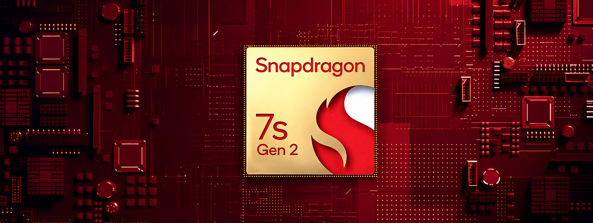
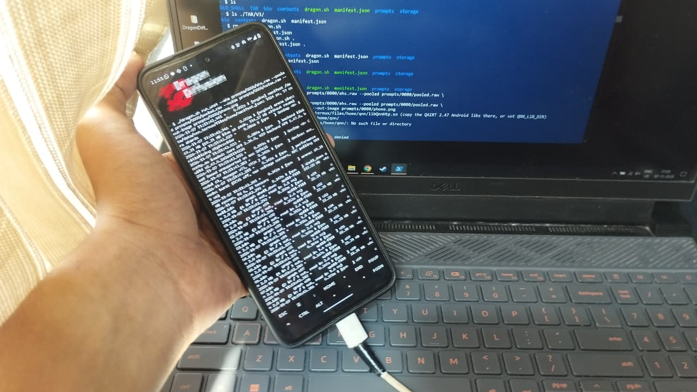
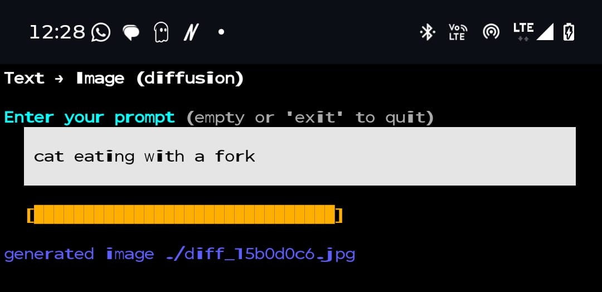

# Dragon Diffusion

<p align="center"></p>

SDXL has 2.57 billion weights. That is about 2.6 GB even at 8 bit, and a mid range phone cannot keep it in memory, so Android kills the app.
Normal SDXL also needs 25 to 50 steps for one image, which is far too slow on a phone.

## Our idea

We did not try to change the model. The model is fine. The real problem is the engine that runs it.

So we picked a ready model, **SDXL Lightning** (it makes an image in just 4 steps), and we worked on the **NPU inference engine** instead.

We run on the **Snapdragon SM7435**, using its **Hexagon NPU (HTP)**. The engine is built on Qualcomm's **QNN runtime**, which we modified for our needs. Everything runs on the phone from Termux. No cloud and no PC after setup.

<p align="center"></p>

## The Dragon Inference Engine

### The big idea

A model uses memory in two different ways, so we handle them in two different ways.

* **Weights** are huge. The core alone is about 2.4 GB. They never change, and we need them one piece at a time, always in the same order. So we **stream** them. We load a piece, use it, and throw it away.
* **Activations** are the working data while the model runs. They are small, and their sizes never change. So we **plan** them once, before the first step, and keep them all in one shared block of memory.

Four simple rules sit under everything:

1. **Decide everything early.** Shapes, scales, cut points and memory positions are all fixed on the PC. The phone never has to decide where to put anything while it runs.
2. **Use fixed shapes only.** Batch 1, a 128 × 128 latent and 77 text tokens. Nothing changes from step to step, so every step uses the same memory and takes about the same time.
3. **Load and run at the same time.** The NPU should never sit and wait for weights.
4. **Use one memory space.** The CPU and the NPU read the same bytes. We never copy data between them.

### 1. How we cut the model

We cut the SDXL Lightning UNet into 19 pieces that run one after another:

shell_down, then c01 to c17, then shell_up

* **The shell is about 190 MB.** It has the input layer, the time embedding, the pooled text embedding, the first two big down blocks, the last big up blocks and the output layer. It has few weights, but it works on the biggest tensors. It stays loaded the whole time.
* **The core is about 2.38 billion weights, which is 93% of the model.** It is everything from down block 2 inward, the small resolution middle where the transformers are. We cut it into **17 shards of about 120 to 155 MB each**.

It is not a simple chain, because a UNet has skip connections. Some outputs are needed much later in the run. So for every shard we write down exactly what it reads and what it writes: the hidden data, the skip tensors, the time embedding and the text data. This list is the manifest. From it, the engine knows the full flow of data, and the memory planner uses this to decide where everything goes.

We pick the cut points by reading only the header of the checkpoint, so we do not need to download the weights. Then we check the cut is right by running the pieces in order and comparing with the original UNet on the same input.

### 2. What we prepare on the PC

Every piece goes through the same steps:

1. Export it with a fixed shape.
2. Run real prompts through it and record the value range of every tensor at every step. This is called calibration.
3. Convert it with QAIRT to **8 bit weights and 16 bit activations**.
4. Compile it into a **context binary** made for the exact SM7435 Hexagon chip.

Two things here matter a lot.

**All pieces share the same scales.** Whenever a tensor goes from one shard to the next, both shards use the exact same scale for it. So the tensor that shard 5 writes is already in the form shard 6 wants to read. We never convert it back and forth, we lose no extra precision, and there is no extra glue work. The 17 shards act like one single model.

**A context binary is already in the form the NPU wants.** So on the phone, loading a shard is only reading a ready file. There is nothing to compile. This is why streaming works. Loading is cheap enough that we can do it 68 times for one image.

### 3. How we handle the working data: one planned memory block

All the activations, skip tensors, text data and the latent live in **one block of shared memory (rpcmem)**. We allocate it once at the start and register it with QNN. Each context binary reads its inputs from this block and writes its outputs back into it, at fixed positions.

**How we plan it.** The graph and shapes are fixed, so we know exactly when each tensor is first used and when it is last used. That is its lifetime. We then place the tensors in the block like bars on a timeline. If two tensors are never alive at the same time, they can use the same bytes. So the size of the block is set by the most data alive at one moment, not by the total of all tensors.

The tensors fall into three groups:

* **Alive for the whole run:** the text embeddings and pooled embeddings. Every cross attention shard reads them, and they stay for all 4 steps.
* **Alive for one step:** the skip tensors. A skip made on the way down has to wait until the matching block on the way up. These live the longest inside a step, so they decide most of the peak memory.
* **Alive for a short time:** the hidden data passed from one shard to the next, and each shard's scratch space. A hidden tensor lives only from the shard that makes it to the shard that reads it. So the same regions get reused again and again along the chain.

**No copying.** The NPU and the CPU see the same physical memory. So the CPU can write the latent in, read the noise prediction out and run the scheduler, and no data has to move. Only the offsets change.

**How we know it is safe.** Sharing memory is risky. If one lifetime is wrong, a tensor gets overwritten while something still needs it. So we run the engine on a fake NPU backend and make sure the shared block gives results **exactly the same** as a run where every tensor has its own private buffer. Any bad overlap shows up as a difference.

### 4. How we handle the weights: the shard streamer

We load and free weights shard by shard, using a few **slots**. One slot holds one core shard, up to about 155 MB. The default is 2 slots.

Each shard goes through these states: empty, loading, ready, running, freed.

* While shard k runs on the NPU, shard k+1 loads in the background.
* When shard k finishes, we free it right away. Its slot goes to shard k+2.
* The first shard, c01, starts loading while `shell_down` is still running. So even the first load is hidden.

This is what it looks like once it is running smoothly:

```
NPU    : [ shell_down ][ c01 ][ c02 ][ c03 ] ... [ c17 ][ shell_up ]
loader :   [ load c01 ][ load c02 ][ load c03 ][ load c04 ] ...
```

**How long one step takes.** In words:

time for one step = shell_down + (for each shard, the longer of its run time and the load time of the next shard) + shell_up + scheduler

This tells us a lot. If a shard takes longer to run than the next shard takes to load, then loading costs us nothing, and the NPU is the limit. If loading takes longer, then load speed is the limit. We measure the load, run and free time of every shard, both one by one and with streaming, so we can see which one is holding us back.

**How much memory we use.** The weights in memory are the shell plus the slots times the biggest shard. With 2 slots that is about 190 MB plus about 300 MB. The shared block for activations sits on top. A normal load would need 2.6 GB.

**What it costs us.** We free every shard after we use it. So every step has to load the whole core again. Over 4 steps that is about 68 shard loads, around 9.5 GB of weights read for one image. So we spend loading speed to save memory. For a phone this is a good deal, because running out of memory is what gets the app killed, and loading in the background hides most of the cost.

### 5. What if the phone runs low on memory

Other apps share the phone's memory, and the free memory can go down while we run. If a shard fails to load, the streamer **goes down from 2 slots to 1 and keeps going**. With 1 slot, loading and running cannot happen together anymore, so each shard takes its run time plus its load time. The image comes out slower, but it still comes out. We would rather be slow than get killed.

### 6. One denoising step from start to end

1. The CPU writes the current latent into the shared block.
2. `shell_down` runs. It makes the first skip tensors and the hidden data.
3. c01 to c17 run through the streamer. The shards on the way down make skips, and the shards on the way up use them.
4. `shell_up` uses the saved skips, and the output layer writes the noise prediction.
5. The CPU does an Euler update on the latent. It matches SDXL Lightning, with trailing timesteps and epsilon prediction. This is a tiny job on a small tensor, so it stays on the CPU.

The batch is 1, so there is one UNet pass per step. We do this 4 times. Then TAESDXL turns the final latent into the 1024 × 1024 image. It is compiled for the same NPU and uses the same shared memory.

The text prompt comes in as ready made CLIP outputs: prompt embeddings of shape [1, 77, 2048] and pooled embeddings of shape [1, 1280].

Every step runs the full core at full quality. Our design has a place to reuse the core output between steps. That would skip whole 17 shard passes and save both loading and running time. We do not use it yet.

### 7. What the engine tells us after a run

Every run prints the peak RAM of the process, the peak NPU shared memory, and how much the phone's free memory dropped. Together these show that the full model ran without ever being fully in memory.

## Results

* The full SDXL Lightning model runs on the phone NPU without ever being fully in memory.
* Memory in use: about 300 MB of core shards plus the 190 MB shell, instead of 2.6 GB.
* Steps: 4, instead of 25 to 50.
* Output: 1024 × 1024 PNG.
* Time per image: add your number here
* Peak RAM: add your number here

Running on the phone from Termux:

<p align="center"></p>

Typing a prompt and getting an image:

<p align="center"></p>
